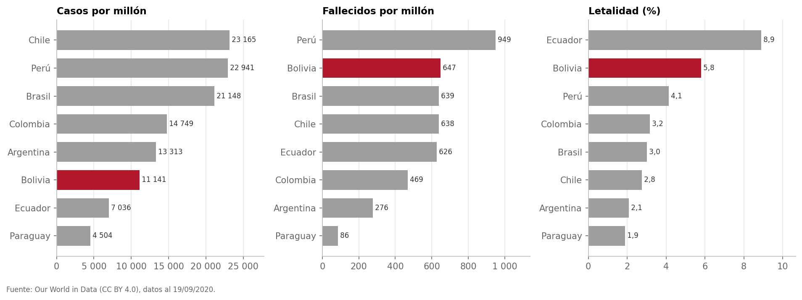
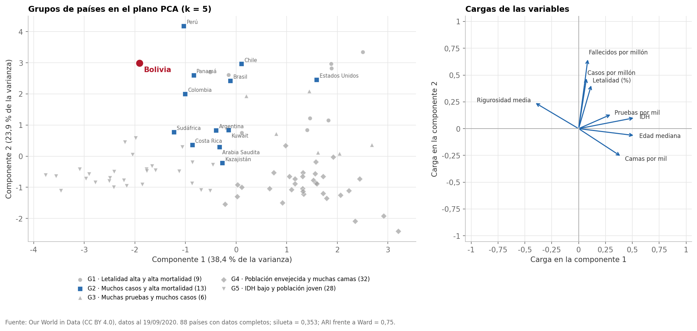
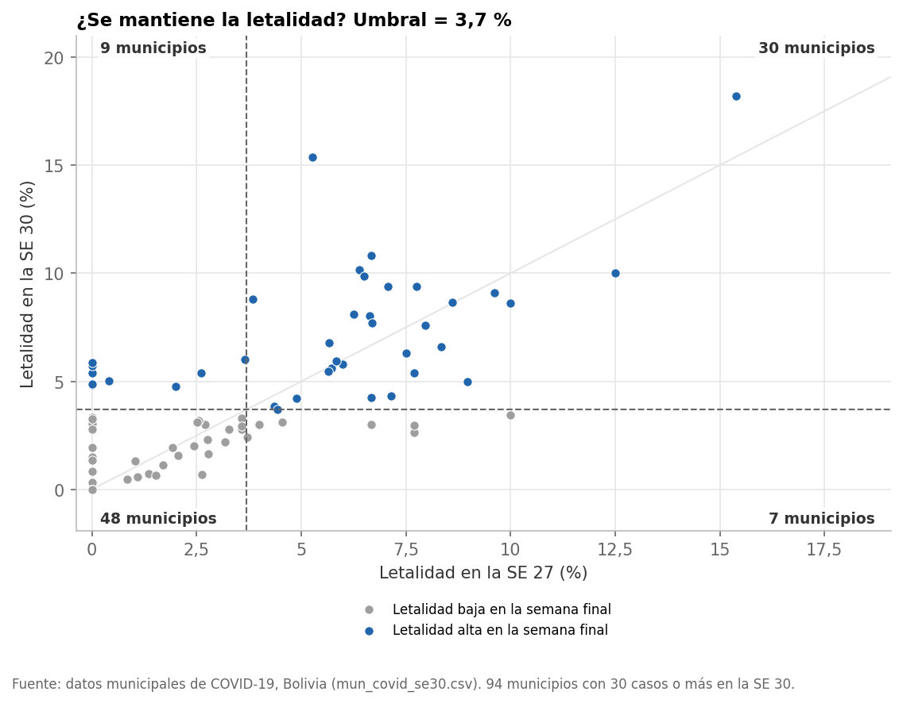

# Respuesta sanitaria de Bolivia frente al COVID-19

Estudio reproducible de ciencia de datos sobre la primera ola de COVID-19 en Bolivia, con datos
al 19/09/2020. Un solo comando recalcula todo a partir de los datos crudos incluidos en el
repositorio (sin descargas) y genera las figuras y una página web de resultados.

**Autor:** Henry Pilco Cussy · Ingeniería de Sistemas · Universidad Privada Franz Tamayo

> Página de resultados: `docs/index.html` (se publica con GitHub Pages desde `main` → `/docs`).

---

## Objetivo y pregunta de investigación

**Objetivo.** Evaluar la respuesta sanitaria de Bolivia durante la primera ola del COVID-19
comparándola con sus vecinos y con el resto del mundo, y medir qué tan anticipables eran la
evolución de los casos y la letalidad municipal.

**Pregunta principal.** ¿Qué tan grave fue el impacto del COVID-19 en Bolivia en relación con su
capacidad sanitaria, y qué información disponible en su momento permitía anticipar la evolución
de los casos y de la letalidad?

Se responde con tres modelos:

| Modelo | Pregunta | Método |
|---|---|---|
| 1 · Perfiles | ¿A qué países se parece Bolivia? | k-means sobre 8 indicadores, validado con Ward y semillas |
| 2 · Pronóstico + IPS | ¿Qué tan predecibles eran los casos? ¿Cuánta presión soportaron los hospitales? | 6 modelos con validación de origen móvil; índice de presión sanitaria |
| 3 · Riesgo municipal | ¿Se podía anticipar qué municipios tendrían letalidad alta? | Árbol, bosque aleatorio y regresión logística frente a dos líneas base |

## Resumen de resultados

Valores obtenidos con la configuración por defecto (`config.yaml`).

- **Mortalidad alta con pocos casos detectados.** Bolivia tenía 647 fallecidos por millón (2.º de
  8 países sudamericanos) y una letalidad de 5,8 % (2.º), pero era 6.º en casos por millón: señal
  de subregistro de casos.
- **Perfil.** Entre 88 países, k-means (k = 5, silueta 0,353, ARI frente a Ward 0,75) ubica a
  Bolivia en un grupo de 13 países de alta mortalidad junto a Perú, Brasil, Chile, Colombia y
  Estados Unidos. Su vecino más cercano es Colombia. Bolivia destaca por una mortalidad muy alta
  (+2,3 DE) pese a una de las cuarentenas más estrictas (+2,1 DE).
- **Pronóstico.** El pico semanal fue de 11 102 casos (semana al 08/08/2020). Holt con tendencia
  amortiguada fue el mejor modelo (RMSE ≈ 2 774) y redujo el error del modelo ingenuo en 17 %,
  pero **todos los modelos tienen R² negativo**: ninguno anticipó el pico.
- **Presión hospitalaria.** El índice de presión sanitaria llegó a 1,76 casos de 14 días por cama
  el 28/07/2020 (12 840 camas), el 4.º más alto de 8 países. Igualar la mediana regional habría
  requerido 3 592 camas más (+28 %).
- **Riesgo municipal.** En 94 municipios, la regla de **persistencia** («si la letalidad de la
  semana 27 ya superaba 3,7 %, seguirá alta») logra F1 = 0,79 y AUC = 0,83; el mejor modelo
  (bosque aleatorio) logra F1 = 0,76 y AUC = 0,83. Ningún modelo supera a la regla simple.

<p align="center">
  
</p>
<p align="center">
  
</p>
<p align="center">
  
</p>

## Estructura del proyecto

```
config.yaml              todos los parámetros del estudio
requirements.txt         dependencias con versiones exactas
run_all.py               ejecuta todo el pipeline con un solo comando
src/
  config.py              carga config.yaml y define las rutas desde la raíz del proyecto
  datos.py               carga, limpieza y controles de calidad
  eda.py                 análisis exploratorio
  modelo_perfiles.py     Modelo 1 · perfiles de países (k-means)
  modelo_series.py       Modelo 2 · pronóstico e índice de presión sanitaria
  modelo_riesgo.py       Modelo 3 · riesgo de letalidad alta por municipio
  figuras.py             estilo común de gráficos y funciones de dibujo
  web.py                 genera la página web a partir de los JSON
plantillas/index.html.j2 plantilla Jinja2 de la página
datos/crudos/            datos originales (no se modifican)
datos/procesados/        datos limpios generados (no se versionan)
resultados/              un JSON por módulo: calidad, eda, perfiles, series, riesgo
figuras/                 figuras PNG generadas
docs/                    página web generada para GitHub Pages
tests/                   pruebas con pytest
.github/workflows/ci.yml integración continua
```

## Cómo ejecutarlo

Requisitos: Python 3.11. Tiempo total aproximado: 3 minutos.

**Windows (PowerShell)**

```powershell
python -m venv .venv
.\.venv\Scripts\Activate.ps1
python -m pip install -r requirements.txt
python run_all.py
python -m pytest
```

> Si PowerShell bloquea la activación del entorno, ejecute una vez
> `Set-ExecutionPolicy -Scope CurrentUser RemoteSigned`.

**Linux o macOS (bash)**

```bash
python3.11 -m venv .venv
source .venv/bin/activate
python -m pip install -r requirements.txt
python run_all.py
python -m pytest
```

Cada módulo también puede ejecutarse por separado desde la raíz, por ejemplo
`python -m src.modelo_series` o `python -m src.figuras`. Al terminar, abra `docs/index.html` en el
navegador.

## Índice de figuras

| Archivo | Contenido |
|---|---|
| `eda_evolucion_nacional.png` | Casos, fallecidos y letalidad nacional acumulados por semana |
| `eda_histogramas.png` | Distribución de confirmados (escala log) y letalidad por municipio |
| `eda_departamentos.png` | Confirmados y letalidad por departamento |
| `eda_boxplot_letalidad.png` | Letalidad municipal por departamento con prueba de Kruskal-Wallis |
| `eda_spearman.png` | Correlaciones de Spearman entre variables municipales |
| `eda_comparacion_casos.png` | Casos diarios por millón (media móvil de 7 días), 8 países |
| `eda_comparacion_indicadores.png` | Casos y fallecidos por millón y letalidad al corte |
| `perfiles_silueta.png` | Silueta media según k en ambas muestras |
| `perfiles_pca_mundial.png` | Plano PCA de 88 países con sus grupos y cargas de las variables |
| `perfiles_grupos.png` | Perfil estandarizado medio de cada grupo |
| `perfiles_regional.png` | Plano PCA de los 8 países sudamericanos |
| `series_validacion.png` | Pronósticos a 4 semanas desde cada corte frente a lo observado |
| `series_metricas.png` | RMSE por modelo y según el horizonte |
| `series_proyeccion.png` | Proyección con intervalos empíricos (Holt) y de ARIMA |
| `series_ips.png` | Índice de presión sanitaria diario, 8 países |
| `series_escenarios.png` | IPS pico de Bolivia con +0, +25, +50 y +100 % de camas |
| `riesgo_metricas.png` | F1 y AUC con IC 95 % de cada modelo frente a la persistencia |
| `riesgo_confusion.png` | Matrices de confusión medias de la persistencia y del bosque |
| `riesgo_importancia.png` | Importancia de variables por permutación (caída del AUC) |
| `riesgo_persistencia.png` | Letalidad en la semana 27 frente a la 30, por municipio |

## Decisiones metodológicas

| Decisión | Por qué | Alternativa descartada |
|---|---|---|
| Datos de la **fecha de corte exacta** para acumulados (Modelo 1) | Compara a todos los países el mismo día | Último dato disponible: suma España (89 países) pero mezcla fechas |
| **Pruebas por mil**: último dato disponible | Muchos países informan pruebas con rezago | Exigir la fecha de corte dejaría fuera a la mayoría |
| No imputar faltantes en k-means | Imputar IDH o pruebas inventaría justo lo que se compara | Imputación por media o KNN |
| **k ≥ 3** en la muestra mundial | Con k = 2 la partición solo separa países ricos de pobres | Aceptar el máximo de silueta sin restricción |
| Validar k-means con **Ward y 50 semillas** (con 50 y con 1 inicio) | Comprueba que los grupos no dependan del algoritmo ni del azar | Solo la silueta |
| Semanas que cierran en **sábado** | El 19/09/2020 es sábado: la última semana queda completa | Semanas ISO (lunes a domingo) |
| **Validación de origen móvil** (13 cortes) | Cada pronóstico usa solo el pasado, como en la práctica | Una sola partición entrenamiento/prueba |
| **MASE** y **MAE relativo al ingenuo** | El R² y el MAPE engañan con series con pico; el ingenuo es la referencia honesta | Solo RMSE y R² |
| **Intervalos empíricos** a partir de los errores de validación | No suponen normalidad de los errores | Intervalos teóricos de un solo modelo |
| ARIMA sobre **log1p** con p, q por AIC | Estabiliza la varianza y garantiza pronósticos positivos | ARIMA en escala original |
| IPS con **camas totales** y **14 días** de casos | OWID no publica camas UTI para la región; 14 días ≈ duración de la enfermedad | Camas de terapia intensiva (sin datos) |
| Kruskal-Wallis solo con departamentos de **≥ 2 municipios** | Un grupo de un valor no tiene dispersión | Incluir todos (H = 29,8) |
| **Persistencia** como línea base del Modelo 3 | Es la predicción gratuita que cualquier modelo debe superar | Comparar solo con la clase mayoritaria |
| IC 95 % con **corrección de Nadeau y Bengio** | Los pliegues de la validación repetida no son independientes | Intervalo t ingenuo (demasiado estrecho) |
| Importancia por permutación en **pliegues de prueba**, departamento permutado **en bloque** | Mide lo que generaliza; permutar una dummy sola crea filas imposibles | Importancia de Gini del bosque |

## Limitaciones

- **Subregistro.** Los casos confirmados dependen de cuántas pruebas se hicieron; Bolivia tenía
  pocas pruebas por habitante, por lo que los casos (y la letalidad aparente) están sesgados.
- **IPS con camas totales**, no de terapia intensiva: mide presión relativa, no ocupación real.
  Además, una sola cifra de camas por país ignora su distribución geográfica.
- **Muestras pequeñas.** 8 países en la muestra regional (estructura de grupos débil, silueta
  0,17), 28 semanas en el pronóstico (13 errores por horizonte para los intervalos) y 94
  municipios en el Modelo 3.
- **Datos municipales incompletos.** Falta la semana 26 y hay correcciones retroactivas (5
  descensos de confirmados acumulados y 6 de fallecidos) que se informan sin modificarse.
- **Correcciones en OWID.** Ecuador tiene 4 días con casos negativos y Chile un reporte acumulado
  en junio, que distorsionan sus curvas diarias.
- **Asociación, no causalidad.** Ningún modelo permite atribuir la mortalidad a una política.
- **Versiones.** El RMSE de Holt (2 774) difiere 0,3 % del proyecto original (2 782) por la
  versión de statsmodels; la conclusión no cambia.

## Cómo adaptar el estudio a otro país o periodo

Todo se controla desde `config.yaml`; no hace falta tocar el código.

1. **País foco y comparación:** `pais.nombre`, `pais.iso` y `pais.comparacion` (nombres como
   aparecen en la columna `location` de OWID). Añada traducciones en `pais.nombres_es`.
2. **Periodo:** `fecha_corte` y `series.fecha_inicio`. Si usa un archivo de OWID más reciente,
   reemplácelo en `datos/crudos/` o cambie `archivos.owid`.
3. **Datos subnacionales:** reemplace `archivos.municipios` por un CSV con las mismas 9 columnas en
   el mismo orden (ver `DICCIONARIO_DATOS.md`) y ajuste `municipios.semana_inicio`,
   `semana_fin`, `semana_referencia` y `nombres_departamento`.
4. **Umbrales y modelos:** `municipios.umbral_letalidad`, `min_casos_modelo`,
   `series.horizonte`, los hiperparámetros de `riesgo` y la `semilla`.
5. Ejecute `python run_all.py` y `python -m pytest`. Las pruebas de aceptación del proyecto
   original se omiten automáticamente cuando la configuración no es la por defecto.

Los títulos y avisos de la página web se eligen según los resultados (por ejemplo, el aviso de
R² negativo solo aparece si ocurre), de modo que el texto sigue siendo correcto con otros datos.

## Fuentes y licencias

- **Our World in Data**, *COVID-19 dataset*, <https://github.com/owid/covid-19-data>, datos al
  19/09/2020. Licencia [CC BY 4.0](https://creativecommons.org/licenses/by/4.0/).
- **Oxford COVID-19 Government Response Tracker** (origen de `stringency_index`), Hale *et al.*
  (2021), *Nature Human Behaviour*, 5, 529–538.
- **Datos municipales de Bolivia** (`mun_covid_se30.csv`), semanas epidemiológicas 20 a 30 de
  2020. *Fuente y licencia pendientes de confirmar* (ver `DICCIONARIO_DATOS.md`).
- **Código:** licencia [MIT](LICENSE). Para citar este trabajo use [`CITATION.cff`](CITATION.cff).

Referencias metodológicas: Hyndman y Koehler (2006) para el MASE; Nadeau y Bengio (2003) para la
corrección de la varianza en validación cruzada repetida.
